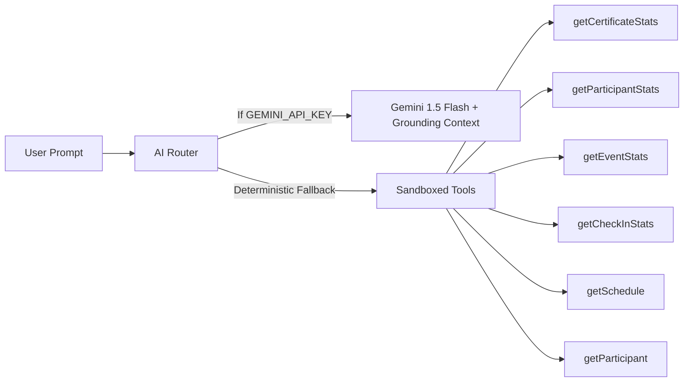

# EventOS AI Operations Copilot Architecture

EventOS incorporates a context-grounded AI copilot designed specifically for physical event directors, stage managers, and security turnstile leads.

---

## 1. Engine & Model Specification

- **LLM Provider**: Google Generative AI (`gemini-1.5-flash`) via official `@google/generative-ai` SDK.
- **Fail-Safe Deterministic Engine**: When running in offline or unkeyed environments, the system falls back to strict sandboxed operational analytics tools rather than fabricating answers.
- **Zero Hallucination Constraint**: The copilot is strictly forbidden from extrapolating or inventing facts outside the verified event records.

---

## 2. Sandboxed Operational Tools

The AI Copilot does not have arbitrary database access. It operates via sandboxed analytical tools that query the live event registry:

### Available Tools
1. **`getEventStats(eventId)`**: Returns total registered, checked-in, capacity, and attendance ratio.
2. **`getParticipantStats(eventId)`**: Analyzes demographics and college-level attendance distributions.
3. **`getCheckInStats(eventId)`**: Reports turnstile velocity (peak scans/sec), ingress gate loads, and bottleneck warnings.
4. **`getSchedule(eventId)`**: Inspects run-of-show, stage tracks, current live keynote, and speaker timelines.
5. **`getCertificateStats(eventId)`**: Returns count of issued/minted certificates vs pending eligible attendees.
6. **`getParticipant(query)`**: Look up individual attendee by pass code (e.g. `DYN-88912`) or email to check turnstile entry status.

---

## 3. Strict Out-of-Domain Refusal Policy

Any question outside event operations (e.g. general trivia, politics, unrecorded logistics) triggers a deterministic refusal:

> *"I don't have that information in the event records. You can ask me about attendance statistics, gate congestion, sessions schedule, college distributions, or certificate minting progress."*

---

## 4. Verification Test Cases

| Query | Expected Operational Tool | Grounded Database Result |
| :--- | :--- | :--- |
| *"How many participants are registered?"* | `getEventStats` | 1,247 registered attendees |
| *"How many checked in?"* | `getEventStats` | 1,086 checked-in attendees |
| *"Which college has the highest attendance?"* | `getParticipantStats` | CBIT Hyderabad, Vasavi, VBIT |
| *"How many certificates have been issued?"* | `getCertificateStats` | 1,086 verified credentials minted |
| *"What is the event schedule?"* | `getSchedule` | 6 staged keynote & track sessions |
| *"What is the flight speed of an unladen swallow?"* | Refusal Guard | Direct refusal without fabrication |
