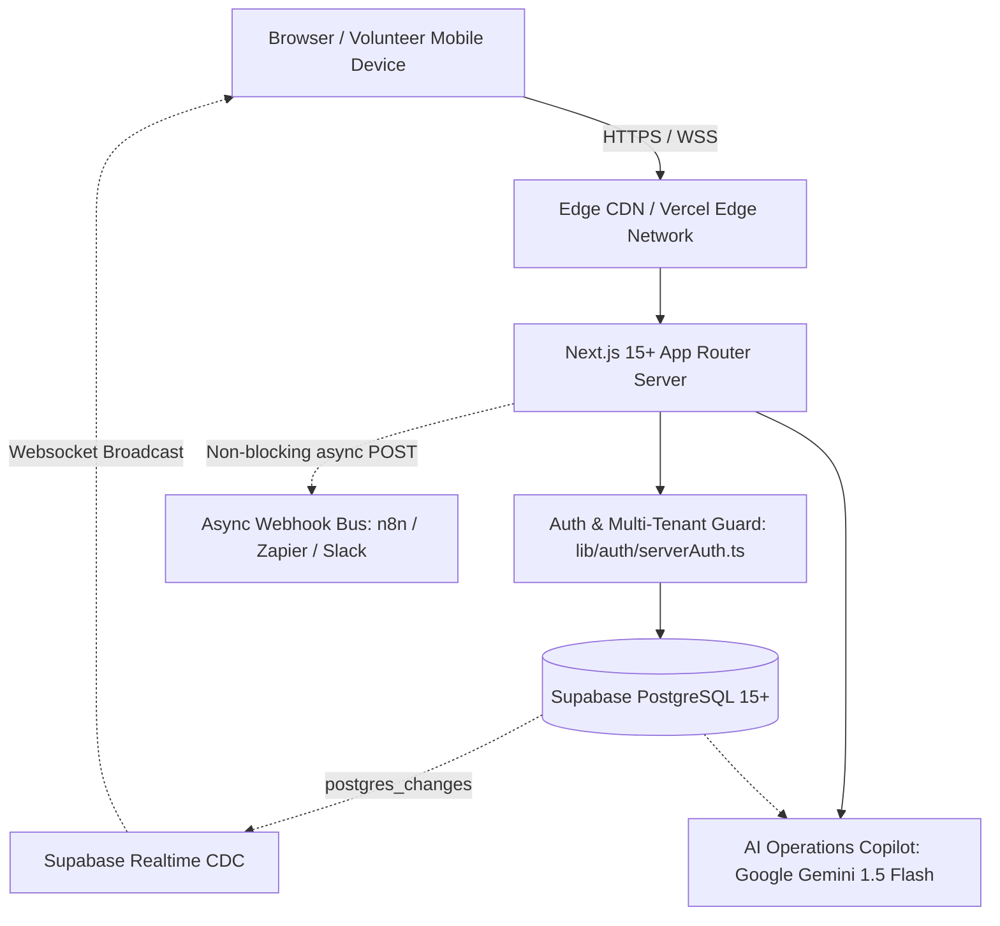

# EventOS Architecture & System Design

**EventOS** is a multi-tenant event operating system engineered for universities, hackathons, conferences, and large-scale technical summits.

---

## 1. System Topology



---

## 2. Multi-Tenant Organizational Hierarchy

EventOS enforces a strict 3-tier organizational model:

```
Organization (e.g. CBIT ACM Student Chapter)
 │
 ├── Organization Members (Roles: ORGANIZER, ADMIN, VOLUNTEER)
 │
 └── Events (e.g. DYNAMITE 2026 Summit)
      ├── Tiers (VIP, Delegate, Speaker, Student)
      ├── Sessions (Keynotes, Workshops, Stage Tracks)
      ├── Ingress Gates (Gate 01, Gate 02 Turnstiles)
      ├── Participants (Registrations, Pass Codes, QR Hashes)
      ├── Check-Ins (Atomic turnstile admissions)
      └── Certificates (Digitally verifiable attendee credentials)
```

### Multi-Tenant Isolation Guarantees
1. **Organization Boundary**: Every event belongs to exactly one `organization_id`.
2. **Access Control**: Users can only read or mutate events belonging to organizations where they possess an active membership in `organization_members`.
3. **Staff Scoping**: Gate staff and volunteers can be optionally restricted to a specific `assigned_event_id`, preventing ingress staff from scanning or querying events outside their assigned post.

---

## 3. Technology Stack

| Layer | Technology | Purpose |
| :--- | :--- | :--- |
| **Framework** | Next.js 15+ (App Router, Turbopack) | Server Components, Edge Routes, API Endpoints |
| **Language** | TypeScript 5+ | Full-stack end-to-end type safety |
| **Styling** | Vanilla CSS + Tailwind CSS | "Obsidian Kinetic" theme (Dark mode, neon cyan `#00F0FF`, emerald `#00FF66`, glassmorphism) |
| **Database** | Supabase (PostgreSQL 15+) | Relational persistence, Row-Level Security, ACID transactions |
| **Realtime** | Supabase Realtime Engine | Change Data Capture (CDC) over WebSockets for turnstile counts |
| **Auth** | Supabase Auth + JWT Bearer Tokens | Cookie sessions and API Bearer token authorization |
| **Document Engine** | `pdf-lib` | Server-side vector PDF generation for verifiable certificates |
| **AI Intelligence** | `@google/generative-ai` (Gemini 1.5 Flash) | Context-grounded operational analytics copilot |
| **Automation** | HTTP Webhook Bus | Asynchronous, non-blocking dispatch to n8n / Zapier / Slack |

---

## 4. UI/UX Design System ("Obsidian Kinetic")

The design system strictly preserves the **Stitch UI** frozen baseline:
- **Base Background**: Obsidian `#050811` and deep slate `#0B0F19`.
- **Primary Accents**: High-visibility Cyber Cyan (`#00F0FF`) and Terminal Emerald (`#00FF66`).
- **Typography**: Inter, JetBrains Mono (for passcodes, metrics, transaction hashes).
- **Feedback & States**: Micro-animations on turnstile check-in (green flash on valid pass, crimson pulse on duplicate scan), holographic pass overlays, and live status badges.

---

## 5. Turnstile Processing Architecture

Turnstile throughput is designed to handle high-velocity burst arrivals at physical venue gates:

1. **Client Scanner**: High-speed camera scanner running on volunteer mobile browsers reads the payload:
   `EVTOS:<EVENT_PREFIX>:<PASS_CODE>:<SHA256_HASH>`
2. **Sanitization**: Scanner normalizes raw codes, extracts the pass code, and dispatches `POST /api/check-in`.
3. **Atomic Mutex**: The backend executes the atomic database stored procedure `process_check_in` which locks the participant record (`SELECT ... FOR UPDATE`), records admission in `check_ins`, and increments event metrics.
4. **CDC Broadcast**: Supabase emits a `INSERT` event to the `check_ins:event_id=eq.{eventId}` channel, updating all organizer dashboard telemetry graphs within milliseconds without polling.
5. **Non-Blocking Automation**: Check-in triggers asynchronous webhook dispatch to n8n for email confirmation and badge printing.
